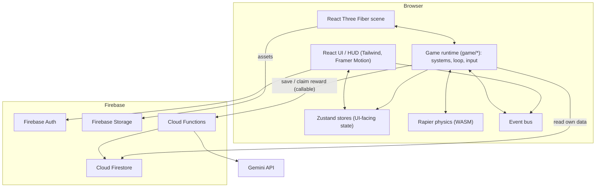

# OPENVERSE — Architecture

This document defines the technical architecture of OPENVERSE. It is a living document:
each phase must update the relevant section when it changes the design.

---

## 0. Implementation Status (as of Phase 1)

Sections 1–10 below describe the **target** architecture. This section records what
actually exists in the repository today.

### 0.1 IMPLEMENTED

| Area            | Actual choice / version                                                                                                                                                      |
| --------------- | ---------------------------------------------------------------------------------------------------------------------------------------------------------------------------- |
| Runtime         | Node.js ≥ 20.9 required (developed on v24.13.0), npm 11                                                                                                                      |
| Framework       | **Next.js 16.3.8** (App Router, default server output), **React 19.2.8**                                                                                                     |
| Language        | **TypeScript 5** — `strict`, `noUncheckedIndexedAccess`, `noImplicitOverride`, `noFallthroughCasesInSwitch`                                                                  |
| 3D Engine       | **Three.js 0.186**, **@react-three/fiber 9.8**, **@react-three/drei 10.7**                                                                                                   |
| 3D Canvas       | `components/game/GameCanvas.tsx` — R3F canvas, DPR clamping [1, 2], perspective camera, soft shadows                                                                         |
| 3D Environment  | `components/game/SkyEnvironment.tsx` (Drei `<Sky />` & distance fog), `Lighting.tsx` (sun + ambient + hemisphere, 2048x2048 shadow maps)                                     |
| Prototype World | `components/game/PrototypeGround.tsx` (260m x 260m ground plane, center spawn pad, depth/shadow reference monoliths)                                                         |
| Debug Tools     | `components/game/DebugGrid.tsx` (140m grid + XYZ coordinate axes helper, toggleable from HUD)                                                                                |
| Error Boundary  | `components/game/WebGLErrorBoundary.tsx` (graceful WebGL context failure screen with home return)                                                                            |
| Loading UI      | `components/game/CanvasLoader.tsx` (accessible loading indicator during 3D asset initialization)                                                                             |
| Play Route      | `app/play/page.tsx` & `PlayClientView.tsx` (client-only dynamic 3D viewport, development HUD overlay)                                                                        |
| Styling         | **Tailwind CSS 4** via `@tailwindcss/postcss`; design tokens in `app/globals.css` (`@theme`)                                                                                 |
| Fonts           | `next/font/google` — Outfit (display), Inter (body)                                                                                                                          |
| Lint            | **ESLint 9** flat config (`eslint-config-next` core-web-vitals + typescript), `no-explicit-any` = error, `consistent-type-imports`, `import/order`, `eslint-config-prettier` |
| Format          | **Prettier 3** + `prettier-plugin-tailwindcss`                                                                                                                               |
| Unit tests      | **Vitest 5** + jsdom + Testing Library (`@testing-library/react`, `jest-dom`) — 13 tests passing                                                                             |
| E2E tests       | **Playwright** (Chromium desktop) — landing to /play smoke test                                                                                                              |
| App shell       | `/` landing page with brand hero and `/play` 3D engine viewport                                                                                                              |
| Config          | `lib/config/project.ts` — single source for name, tagline, current/next phase                                                                                                |
| Git             | Repository initialised on `main`; clean history, `.gitignore`, `.gitattributes`                                                                                              |
| Env             | `.env.example` with placeholders only — **no variable is read by the app yet**                                                                                               |

### 0.2 INSTALLED BUT NOT YET USED

These are installed so upcoming phases don't disrupt the toolchain:

| Package               | Version | First used in                            |
| --------------------- | ------- | ---------------------------------------- |
| `@react-three/rapier` | 2.2     | Phase 3 (Rigid bodies & colliders)       |
| `gsap`                | 3.15    | Phase 2+ (Camera transitions, UI tweens) |
| `framer-motion`       | 14      | Phase 2+ (HUD animations)                |

### 0.3 PLANNED (not installed)

| Package                                | Reason deferred                                | Phase                              |
| -------------------------------------- | ---------------------------------------------- | ---------------------------------- |
| `zustand`                              | No runtime state exists yet                    | Phase 2 (Player stores)            |
| `zod`                                  | No content schemas yet                         | Phase 9                            |
| `firebase` (client)                    | Backend not configured                         | Phase 24 (minimal Functions in 22) |
| `firebase-functions`, `firebase-admin` | Lives in `functions/` package, not initialised | Phase 22/24                        |
| `@google/genai`                        | Server-side only, inside `functions/`          | Phase 22                           |

### 0.4 NOT IMPLEMENTED

The following systems are deliberately **NOT implemented yet**:

- **Player & Movement**: No player mesh, no WASD, no sprint, no jump, no character controller (Phase 2).
- **Physics**: No Rapier physics world, no colliders, no gravity simulation (Phase 3).
- **Open World Regions**: No Town, Forest, Mountain, City, or Coast chunks (Phase 4).
- **Gameplay**: No NPCs, no dialogue, no missions, no inventory, no economy, no audio, no Firebase backend, no AI.
  The camera in Phase 1 is a prototype orbit inspection camera only.
  Firebase, saves, audio. Each corresponding directory contains only a `README.md`
  stating its purpose and target phase. `/profile` and `/settings` routes are **not**
  created yet (they would be empty placeholders).

### 0.5 Phase 0 decisions & deviations

- **Scaffolded at the repository root** (not an `openverse/` sub-folder). Package name is
  `openverse`; the folder name is irrelevant to the build.
- **npm workspaces deferred.** `functions/` is only a documented directory today and is
  excluded from the root `tsconfig.json`. Workspaces will be configured when the Functions
  package is initialised (Phase 22/24).
- **`@types/node` set to `^24`** (template default was `^20`) — required by Vitest 5's peer
  range and matches the installed Node runtime.
- **ESLint stays on v9** because `eslint-config-next@16.3.8` targets it, even though npm
  reports ESLint 9 as deprecated. Re-evaluate when `eslint-config-next` supports v10.
- **`npm audit` reports 5 high-severity advisories**, all in the dev-only lint chain
  (`braces` → `micromatch` → `fast-glob` → `@next/eslint-plugin-next`). The suggested
  `npm audit fix --force` would downgrade to `eslint-config-next@14`, so it was **not**
  applied. No runtime/production dependency is affected. Re-check on each phase.
- **`typecheck` runs `next typegen` first**, so globally generated route types
  (e.g. `LayoutProps`) resolve without a prior build.
- **Hosting mode undecided** — default Next.js output for now; static export vs. Firebase
  App Hosting will be decided before Phase 24/31 (see §6.4).
- `AGENTS.md` / `CLAUDE.md` are generated by Next.js 16 for coding agents and are kept.

---

## 1. Guiding Principles

1. **React renders, the game simulates.** React/R3F own the scene graph and UI. Game logic
   lives in plain, framework-agnostic TypeScript modules under `game/`. No per-frame React
   state updates.
2. **Data-driven content.** Missions, NPCs, dialogue, items, locations, and activities are
   defined as typed data in `data/`, validated with schemas, and never hard-coded into
   components.
3. **Server is the authority on value.** XP, currency, rewards, mission completion, and
   purchases are validated by Cloud Functions. The client _requests_; the server _decides_.
4. **Secrets never reach the browser.** Gemini keys and admin credentials live only in Cloud
   Functions (Secret Manager). Firebase _web config_ is public by design and is protected by
   Security Rules + App Check.
5. **Small modules, clear boundaries.** No massive files. Systems communicate through an
   event bus and well-typed interfaces, not direct cross-imports of internals.
6. **Measure before optimizing.** Performance budgets are defined up front; optimizations are
   driven by profiling (R3F perf, Chrome DevTools, Spector.js).

---

## 2. High-Level Overview



---

## 3. Runtime Model (Rendering vs. Simulation)

### 3.1 Layers

| Layer                 | Responsibility                                                                      | Location                               |
| --------------------- | ----------------------------------------------------------------------------------- | -------------------------------------- |
| **Presentation (3D)** | R3F components that _display_ entities; read transforms from refs, not props        | `components/game/`                     |
| **Presentation (UI)** | HUD, menus, dialogue, map; subscribes to coarse store slices                        | `components/hud/`, `components/menus/` |
| **Simulation**        | Systems that mutate runtime state each tick (player, NPCs, missions, time, weather) | `game/`                                |
| **Content**           | Typed, schema-validated definitions                                                 | `data/`                                |
| **Services**          | Firebase, AI proxy client, persistence                                              | `lib/`                                 |

### 3.2 State categories

| Category              | Example                                                           | Storage                                    | React re-render?           |
| --------------------- | ----------------------------------------------------------------- | ------------------------------------------ | -------------------------- |
| **Hot / per-frame**   | Positions, velocities, camera, animation blend                    | Mutable refs, Three objects, Rapier bodies | ❌ Never                   |
| **Warm / gameplay**   | Current objective, nearby interactable, time-of-day bucket        | Zustand store, updated on _change_ only    | ✅ Only subscribed widgets |
| **Cold / persistent** | XP, currency, inventory, mission states, discoveries, world flags | Zustand + Firestore (server-validated)     | ✅ On change               |

Zustand is chosen because it supports **transient subscriptions** (`store.subscribe` without
re-rendering) and works outside React, which lets game systems read/write it directly.

### 3.3 Game loop

- A single `GameLoop` driven by R3F's `useFrame` at the root of the scene.
- **Fixed-timestep simulation** (e.g., 60 Hz) for physics and gameplay; **variable-rate
  rendering** with interpolation. Rapier runs at its own fixed step via `@react-three/rapier`.
- Systems register with a priority order:

```
Input → Player controller → Vehicles → Physics step → NPC AI → Interaction
→ Missions / Events → Discovery → Time / Weather → Audio → Camera → Store sync (throttled)
```

- Low-frequency systems (NPC schedules, chunk streaming, discovery checks) run on throttled
  intervals (e.g., 2–10 Hz), not every frame.

### 3.4 Event bus

A typed pub/sub (`game/core/events`) decouples systems:

```ts
type GameEvent =
  | { type: "interaction/used"; targetId: string }
  | { type: "npc/talked"; npcId: string }
  | { type: "item/picked"; itemId: string; qty: number }
  | { type: "location/entered"; locationId: string }
  | { type: "mission/objectiveCompleted"; missionId: string; objectiveId: string }
  | { type: "worldFlag/changed"; key: string; value: WorldFlagValue };
```

The mission engine, discovery, achievements, and audio listen to events instead of being
called directly by rendering components.

---

## 4. Directory Structure

Based on the reference structure, with justified adjustments (marked ★).

```
openverse/  (repository root)
├── app/                         # Next.js App Router (routes only, thin)
│   ├── layout.tsx
│   ├── page.tsx                 # Landing: OPENVERSE [PLAY]
│   ├── play/page.tsx            # Loads GameCanvas client-side only (dynamic, ssr:false)
│   ├── profile/page.tsx
│   └── settings/page.tsx
│
├── components/
│   ├── game/                    # R3F presentation components
│   │   ├── GameCanvas.tsx       # <Canvas>, Physics provider, loop root
│   │   ├── Player.tsx
│   │   ├── Camera.tsx
│   │   ├── World.tsx            # Chunk host
│   │   ├── NPC.tsx
│   │   └── Vehicle.tsx
│   ├── hud/                     # HUD, Map, MissionPanel, InteractionPrompt, Dialogue, Inventory
│   ├── menus/                   # Pause, settings, main menu
│   └── ui/  ★                   # Shared design-system primitives (buttons, panels)
│
├── game/                        # Framework-agnostic simulation (no JSX where avoidable)
│   ├── core/
│   │   ├── loop/                # GameLoop, fixed-step scheduler, system registry
│   │   ├── state/               # Zustand stores (session, player, ui, world)
│   │   ├── input/               # InputManager, action map (remappable)
│   │   └── events/  ★           # Typed event bus
│   ├── player/{controller,movement,camera,animation}
│   ├── physics/                 # Collider helpers, collision groups, character controller config
│   ├── world/{terrain,buildings,roads,zones,chunks,pointsOfInterest}
│   ├── interaction/  ★          # Generic Interactable registry + proximity query (Phase 6)
│   ├── npcs/{behavior,schedules,dialogue}
│   ├── dialogue/  ★             # Dialogue graph runtime (shared by NPCs, objects, events)
│   ├── missions/{engine,objectives,conditions,consequences}
│   ├── worldState/  ★           # Flags + relationships store (Phase 11)
│   ├── events/  ★               # Dynamic world events (Phase 23)
│   ├── activities/
│   ├── vehicles/
│   ├── inventory/
│   ├── economy/                 # Client-side view; authority lives in functions/
│   ├── progression/             # XP curve, levels, achievements
│   ├── customization/  ★
│   ├── discovery/
│   ├── dayNight/
│   ├── weather/
│   ├── audio/
│   └── persistence/  ★          # Save/load orchestration, dirty tracking, offline cache
│
├── data/                        # Content definitions (typed TS or JSON + schema)
│   ├── missions/ npcs/ dialogue/★ items/ locations/ activities/ world/
│
├── shared/  ★                   # Code shared by client AND Cloud Functions
│   ├── schemas/                 # Zod schemas (save data, mission defs, reward claims)
│   ├── rules/                   # Pure reward/XP/economy formulas (single source of truth)
│   └── types/
│
├── lib/
│   ├── firebase/                # Client SDK init, auth helpers, typed converters
│   ├── ai/                      # Client wrapper calling the AI Cloud Function (no keys)
│   ├── validation/
│   └── utils/
│
├── functions/  ★                # Firebase Cloud Functions (separate package, Node runtime)
│   ├── src/{rewards,economy,saves,ai,events}/
│   └── package.json
│
├── firebase/  ★                 # firestore.rules, storage.rules, firestore.indexes.json
├── public/{models,textures,animations,audio,environments}
├── types/                       # Global/ambient types only
└── tests/
    ├── unit/                    # Vitest — pure systems (missions, economy, XP, chunks)
    ├── e2e/                     # Playwright — landing → play → move → interact
    └── rules/                   # Firestore rules tests (emulator)
```

**Justification for ★ additions**

- `shared/` — server validation is only trustworthy if client and server use the _same_
  formulas and schemas. Duplicated logic drifts.
- `functions/` — Cloud Functions are a separate deployable with its own `package.json`.
- `game/interaction`, `game/dialogue`, `game/worldState` — these are cross-cutting systems
  used by NPCs, objects, missions, and events; nesting them under one owner would create
  coupling.
- `game/core/events` — required for decoupling systems.
- `game/persistence` — save logic must not be scattered across feature modules.

The repository will be an **npm workspaces** monorepo (root app + `functions/`), so
`shared/` can be consumed by both.

---

## 5. Key Systems Design

### 5.1 Player & Camera (Phases 2–3)

- Kinematic character controller using Rapier's `KinematicCharacterController`
  (handles slopes, step-offset for stairs, snap-to-ground, sliding along walls).
- Movement intent from `InputManager` action map → velocity → controller `computeColliderMovement`.
- Third-person orbit camera with pointer lock, damped follow, and **shape/ray-cast collision**
  against static geometry to prevent clipping.
- Anti-stuck: depenetration via controller + "last safe position" fallback if the player
  falls below world bounds.

### 5.2 World & Chunk Streaming (Phases 4–5)

- World is a grid of square chunks (initial proposal: **128 m** chunks, ~**2 km × 2 km**
  initial world → 16 × 16 grid; tunable after profiling).
- Each chunk definition (`data/world/chunks/*.ts`) lists terrain tile, props (by instanced
  type), buildings, POIs, NPC spawns, and region id.
- Streaming rings around the player:
  - **Active (r ≤ 1)**: full detail, physics colliders, NPC simulation.
  - **Visible (r ≤ 3)**: rendered with LOD, no dynamic NPC simulation.
  - **Far**: low-poly impostors / terrain only, or unloaded.
- Terrain: heightfield per chunk (Rapier `HeightfieldCollider`), with stitched edges.
- Instancing (`InstancedMesh` / Drei `<Instances>`) for trees, rocks, lamps, fences.
- Assets: glTF + Draco/Meshopt compression, KTX2 textures, shared material library.

**Initial region layout (original, fictional):**

```
                 [ MOUNTAIN ]
                 /          \
        [ FOREST ]            [ CITY ]
            |                    |
         (road)              [ COAST ]
            |
        [ TOWN ]  ← player spawn
```

The road network physically connects all regions — no teleportation.

### 5.3 Interaction (Phase 6)

```ts
interface Interactable {
  id: string;
  kind: "door" | "npc" | "pickup" | "shop" | "object" | "building" | "activity" | "vehicle";
  position: Vector3Like;
  radius: number;
  prompt: string; // "Talk", "Open", "Pick up"
  canInteract(ctx: InteractionContext): boolean;
  onInteract(ctx: InteractionContext): void; // emits events; no UI coupling
}
```

A registry + spatial query (per active chunk) picks the best target by distance and
view-angle. The HUD only shows `[E] {prompt}` from the store.

### 5.4 NPCs (Phase 7)

- Finite state machine: `IDLE | WALK | WORK | TALK | SIT | SLEEP`.
- Schedules are data (`time range → location + state`), evaluated at low frequency.
- Navigation: waypoint graphs per region initially; navmesh (e.g., recast-navigation-js)
  only if needed.
- Off-chunk NPCs are simulated abstractly (schedule only, no physics).

### 5.5 Dialogue (Phase 8)

- Directed graph of nodes: `line`, `choice`, `condition`, `action`, `end`.
- Conditions/actions reference world flags, inventory, missions, relationships — the same
  condition language used by the mission engine.
- AI-generated lines (Phase 22) plug in as an optional node type, never replacing
  deterministic branches that drive gameplay.

### 5.6 Missions, Non-Linearity & Consequences (Phases 9–11)

```ts
interface MissionDefinition {
  id: string;
  type:
    | "main"
    | "side"
    | "exploration"
    | "delivery"
    | "investigation"
    | "collection"
    | "racing"
    | "rescue"
    | "dynamic";
  title: string;
  giver?: string; // npc id
  availability: Condition[]; // empty = always available
  objectives: ObjectiveDefinition[]; // ordered or parallel groups
  failure?: Condition[];
  rewards: RewardDefinition; // validated server-side
  consequences: Consequence[]; // world flags, relationships, unlocks
}
```

- Mission states: `locked → available → active → completed | failed | abandoned`.
- **Default: no dependencies.** Dependencies are expressed only as explicit `availability`
  conditions when narratively required.
- Multiple missions may be active concurrently; the player picks a tracked one.
- Objectives advance by listening to bus events (`location/entered`, `item/picked`, …).
- `worldState`: typed key/value flags + NPC relationship scores; consequences mutate it
  through a single reducer (auditable, serializable, replayable).

### 5.7 Economy, Progression & Rewards (Phases 17, 21, 29)

- Formulas live in `shared/rules` (pure functions, unit-tested).
- Client shows optimistic UI; authoritative changes go through callable functions:
  `claimMissionReward(missionId)`, `purchaseItem(itemId)`, `claimDiscovery(locationId)`.
- Server re-checks preconditions (mission objectives recorded, not already claimed,
  sufficient funds, plausible timing) inside a Firestore **transaction**.
- Firestore rules **deny client writes** to `currency`, `xp`, `level`, `inventory`, and
  `achievements`.

### 5.8 Day/Night & Weather (Phases 14–15)

- `WorldClock` (configurable ratio, e.g., 1 game day = 24 real minutes).
- Sun direction, sky, fog, light intensity/color, and shadow camera driven by clock.
- Weather state machine (`clear | cloudy | rain | fog | storm`) affecting fog density,
  light, particles (GPU instanced rain), wet-material roughness, and audio layers.

### 5.9 Audio (Phase 26)

- Three.js `PositionalAudio` + a lightweight mixer: ambient beds per region crossfaded by
  zone, footsteps keyed to surface type, UI sounds. Streamed/compressed (Opus/OGG + MP3
  fallback), lazy-loaded per region.

---

## 6. Backend Design (Phases 24–25, 29)

### 6.1 Firestore collections (draft)

```
users/{uid}                         # account profile (display name, settings)
players/{uid}                       # level, xp, currency, character, lastPosition, version
players/{uid}/missions/{missionId}  # state, objective progress, timestamps
players/{uid}/inventory/{itemId}    # qty, equipped
players/{uid}/discoveries/{locId}   # discoveredAt
players/{uid}/achievements/{achId}  # unlockedAt
players/{uid}/vehicles/{vehicleId}  # owned vehicles, state
players/{uid}/worldState/main       # flags + relationships (bounded size)
rewardClaims/{claimId}              # server-only audit log (idempotency)
```

Subcollections keep documents small and allow granular rules. Save data includes a
`schemaVersion` for migrations.

### 6.2 Security model

- **Auth**: Firebase Auth (anonymous first → link to Google/email later, so progress isn't lost).
- **Rules**: owner-only reads; client may write only low-value fields (e.g., settings,
  cosmetic loadout from owned items, last position with rate limits). All value-bearing
  fields are function-only.
- **App Check** (reCAPTCHA Enterprise) on Functions and Firestore.
- **Secrets**: Gemini key in Google Secret Manager via `defineSecret`; never in `NEXT_PUBLIC_*`.

### 6.3 AI NPCs (Phase 22)

```
Client ──(npcId, playerUtterance)──▶ callable fn `npcChat`
          fn builds prompt from: NPC persona (server-side data), location, time,
          relevant world flags, NPC knowledge, short history
          fn ──▶ Gemini ──▶ response
          fn validates/filters output (length, schema, no game-state commands)
Client ◀── text (+ optional *suggested* intent from a whitelisted enum)
```

- AI **cannot** mutate game state directly. Any suggested action is a whitelisted intent
  that the deterministic engine may accept or reject.
- Per-user rate limiting and cost caps; graceful fallback to scripted dialogue.

### 6.4 Hosting

- Next.js built as a **static export** where possible (the game is client-rendered) and
  deployed to **Firebase Hosting**; dynamic/server needs go to Cloud Functions. If SSR
  features become necessary, migrate to **Firebase App Hosting**. Decision recorded in Phase 0.

---

## 7. Performance Budgets (initial targets, to be validated by profiling)

| Metric                 | Target (capable desktop) | Floor (low-end)                |
| ---------------------- | ------------------------ | ------------------------------ |
| Frame rate             | ~60 FPS                  | ≥ 30 FPS                       |
| Draw calls             | < 300                    | < 150 (reduced quality preset) |
| Triangles in view      | < 1.5 M                  | < 500 k                        |
| Active physics bodies  | < 300                    | < 150                          |
| Initial JS (landing)   | < 200 kB gz              | —                              |
| Time to first playable | < 8 s on broadband       | —                              |

Quality presets (Low/Medium/High) control shadow map size, draw distance, LOD bias,
DPR cap, and post-processing.

---

## 8. Multiplayer-Ready Direction (Phases 32–33)

Multiplayer is **out of scope** until Phase 33, but these decisions keep the door open:

- **Firestore is not used for real-time movement/physics.** It is for persistence, social
  data, and lobbies only.
- Future real-time play will use an **authoritative game server** (e.g., Node.js with
  Colyseus or a custom WebSocket/WebTransport server, deployed on Cloud Run/GKE or a
  dedicated game-hosting provider), with client prediction + server reconciliation and
  interest management by chunk.
- Today's design prepares for this by:
  - Separating **intent (input actions)** from **simulation** — inputs can later be sent to a server.
  - Keeping simulation logic in pure, deterministic-friendly modules (`game/`, `shared/`).
  - Giving every entity a stable string ID.
  - Using the chunk grid as the future network interest-management grid.
  - Routing all value changes through server functions already.

---

## 9. Testing Strategy

| Layer       | Tool                                                       | Examples                                                                            |
| ----------- | ---------------------------------------------------------- | ----------------------------------------------------------------------------------- |
| Unit        | Vitest                                                     | Mission state machine, condition evaluator, XP curve, economy math, chunk ring calc |
| Component   | Vitest + Testing Library                                   | HUD widgets, dialogue UI                                                            |
| E2E         | Playwright                                                 | Landing → Play → pointer-lock → move → interact → pause                             |
| Backend     | Firebase Emulator Suite                                    | Security rules, reward claims, idempotency, cheat attempts                          |
| Performance | R3F `<Perf>`, Chrome DevTools, scripted camera fly-through | FPS/draw calls per region                                                           |

---

## 10. Environment Variables

| Variable                                                       | Exposure                                                                   | Purpose                 |
| -------------------------------------------------------------- | -------------------------------------------------------------------------- | ----------------------- |
| `NEXT_PUBLIC_FIREBASE_API_KEY` … `NEXT_PUBLIC_FIREBASE_APP_ID` | Public (by design)                                                         | Firebase web config     |
| `NEXT_PUBLIC_USE_FIREBASE_EMULATORS`                           | Public                                                                     | Toggle emulators in dev |
| `GEMINI_API_KEY`                                               | **Server only** (Secret Manager in prod, `functions/.secret.local` in dev) | AI NPCs                 |

`.env.example` is created during Phase 0 scaffolding; real `.env*` files are git-ignored.
